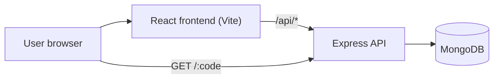
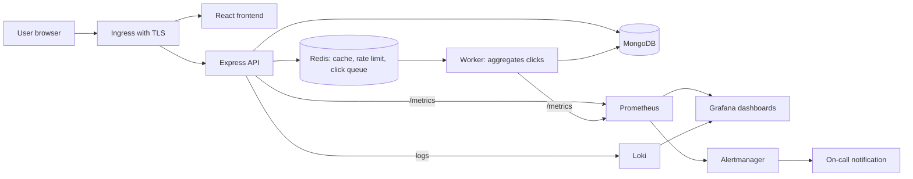
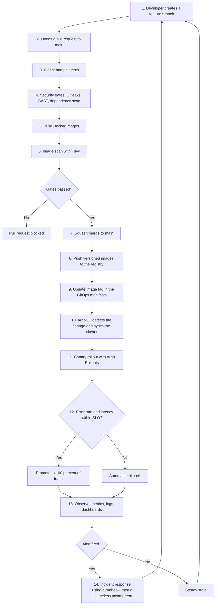
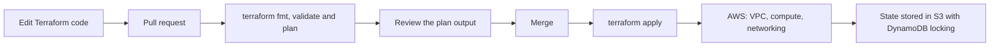
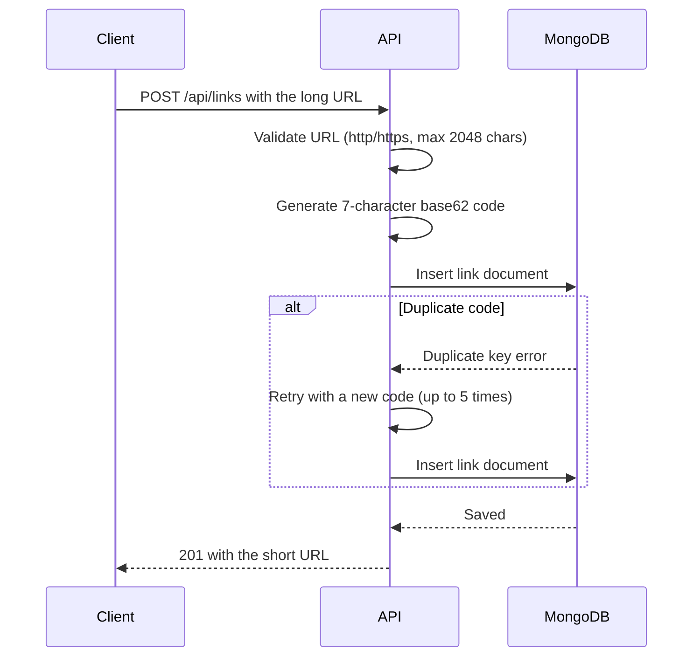
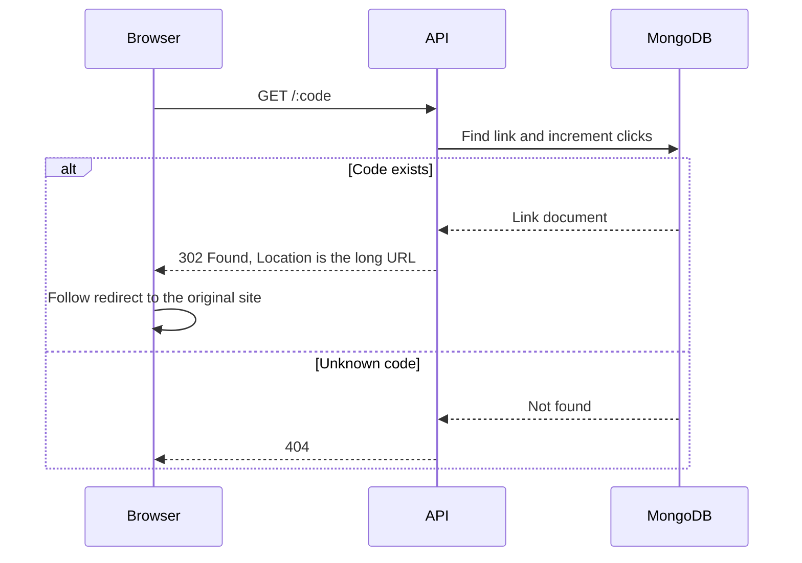
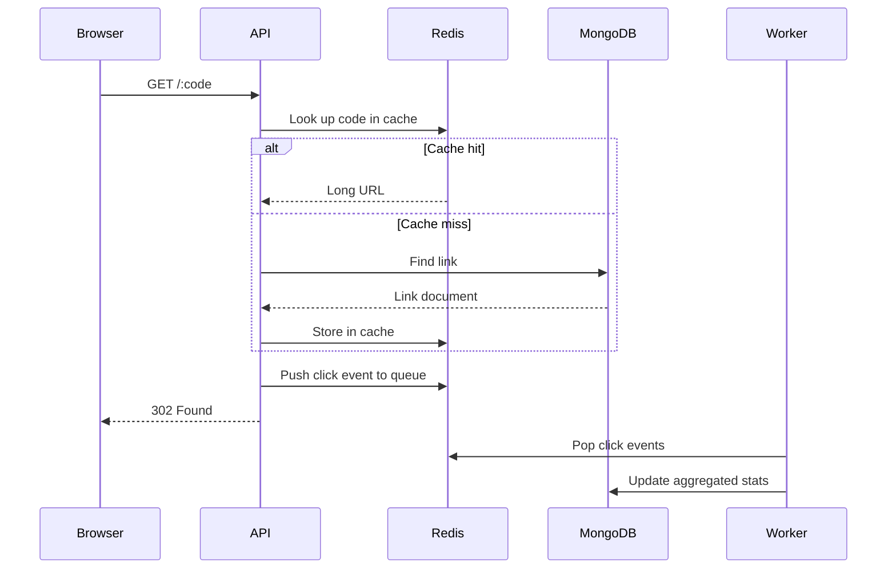

# LinkPulse

A URL shortener with click analytics, built phase by phase as a hands-on DevOps and SRE project. The application is intentionally simple. The goal is to show how a service is built, tested, secured, shipped, observed and kept reliable.

> **Status:** Phases 0 and 1 are complete (working application, Git workflow and Docker Compose). Later phases are planned and are marked as such throughout this document, so nothing here claims more than what exists.

## Table of contents

- [Features](#features)
- [Project status](#project-status)
- [Architecture](#architecture)
- [End-to-end delivery workflow](#end-to-end-delivery-workflow)
- [Request flows](#request-flows)
- [Tech stack](#tech-stack)
- [Project structure](#project-structure)
- [Getting started](#getting-started)
- [Configuration](#configuration)
- [API reference](#api-reference)
- [Environments](#environments)
- [Reliability targets](#reliability-targets)
- [Security](#security)
- [Git workflow](#git-workflow)
- [Roadmap](#roadmap)
- [Troubleshooting](#troubleshooting)
- [License](#license)

## Features

- Shorten any http/https URL into a 7-character base62 code
- `302` redirect with per-link click counting
- Per-link stats (total clicks, last clicked time)
- React UI to create links, copy them and view recent links
- `/health` endpoint for container and Kubernetes probes
- Graceful shutdown on `SIGTERM` and `SIGINT`

## Project status

| Area | Status |
|---|---|
| Application (API and frontend) | Done |
| Git workflow and branch protection | Done |
| Containerization | Done |
| Continuous integration | Planned (Phase 2) |
| Cloud deployment | Planned (Phase 3) |
| Infrastructure as Code | Planned (Phase 4) |
| Kubernetes | Planned (Phase 5) |
| GitOps | Planned (Phase 6) |
| Observability | Planned (Phase 7) |
| DevSecOps | Planned (Phase 8) |
| SRE practices | Planned (Phase 9) |

## Architecture

### Current (Phase 0)



### Target (after all phases)



## End-to-end delivery workflow

This is the target workflow every change follows from a developer's laptop to production. Each step is added in the phase noted in the table below.



### Step-by-step

| # | Step | What happens | Tooling | Phase |
|---|---|---|---|---|
| 1 | Branch | Work starts on a short-lived branch such as `feat/...` | Git | 0 (done) |
| 2 | Pull request | Changes are proposed and reviewed. Direct pushes to `main` are blocked | GitHub rulesets | 0 (done) |
| 3 | CI checks | Lint and automated tests run on every pull request | GitHub Actions | 2 |
| 4 | Security gates | Secret scanning, static analysis and dependency checks run before merge | Gitleaks, CodeQL or SonarQube | 8 |
| 5 | Build | Multi-stage Docker images are built for the API and frontend | Docker | 1 |
| 6 | Image scan | Images are scanned. Critical vulnerabilities fail the build | Trivy | 8 |
| 7 | Merge | The pull request is squash-merged into `main` | GitHub | 0 (done) |
| 8 | Publish | Versioned images are pushed to a registry | GHCR or ECR | 2 |
| 9 | Release | The new image tag is written to the manifests repository | Git | 6 |
| 10 | Deploy | ArgoCD syncs the cluster to match Git and detects drift | ArgoCD | 6 |
| 11 | Canary | New version receives a small share of traffic first | Argo Rollouts | 9 |
| 12 | Analysis | Prometheus queries decide whether to promote or roll back | Prometheus | 9 |
| 13 | Observe | Metrics, logs and dashboards show service health | Prometheus, Grafana, Loki | 7 |
| 14 | Respond | Alerts page the on-call person. Runbooks guide the fix. Postmortems capture lessons | Alertmanager, docs | 9 |

### Infrastructure workflow

Infrastructure follows the same pull request flow, with Terraform in place of an application build.



## Request flows

### Create a short link



### Open a short link (current)



### Open a short link (planned with Redis and worker)



The redirect uses `302` rather than `301`. A `301` is cached by browsers, so repeat clicks would never reach the server and would not be counted.

## Tech stack

| Layer | Technology | Phase |
|---|---|---|
| Frontend | React, Vite | 0 |
| API | Node.js, Express | 0 |
| Database | MongoDB with Mongoose | 0 |
| Cache and queue | Redis | 1 and later |
| Containers | Docker, Docker Compose, Nginx | 1 |
| CI/CD | GitHub Actions | 2 and 3 |
| Cloud | AWS (EC2, then EKS) | 3 and 5 |
| IaC | Terraform | 4 |
| Orchestration | Kubernetes, Helm | 5 |
| GitOps | ArgoCD | 6 |
| Observability | Prometheus, Grafana, Loki | 7 |
| Security | Trivy, Gitleaks, CodeQL or SonarQube | 8 |
| Reliability | Argo Rollouts, k6, Chaos Mesh | 9 |

## Project structure

```
linkpulse/
├── app/
│   ├── api/                # Express API
│   │   └── src/
│   │       ├── models/     # Mongoose models
│   │       ├── routes/     # API routes
│   │       ├── utils/      # Short code generator
│   │       └── server.js
│   └── frontend/           # React and Vite app, Dockerfile and nginx.conf
├── docs/                   # Architecture notes, SLOs, runbooks, postmortems
├── docker-compose.yml      # api, frontend and mongo
├── .gitignore
└── README.md
```

Directories added in later phases: `infra/terraform`, `infra/k8s`, `.github/workflows`, `docs/runbooks`, `docs/postmortems`.

## Getting started

### Option A: Docker Compose (recommended)

Requires Docker with the Compose plugin.

```bash
docker compose up --build
```

Open `http://localhost:8080`. Nginx serves the frontend and forwards `/api/*` and short links to the API. MongoDB data is kept in the `mongo-data` volume.

```bash
docker compose ps          # all services should become "healthy"
docker compose logs -f api # follow API logs
docker compose down        # stop (add -v to also delete the database volume)
```

To change the public base URL used in short links, copy `.env.example` to `.env` and edit `BASE_URL`.

### Option B: Run without Docker

#### Prerequisites

- Node.js 20 or later
- Docker (used here only to run MongoDB) or a local MongoDB installation

#### 1. Start MongoDB

```bash
docker run -d --name linkpulse-mongo -p 27017:27017 mongo:7
```

#### 2. Start the API

```bash
cd app/api
cp .env.example .env
npm install
npm run dev
```

The API listens on `http://localhost:5000`.

#### 3. Start the frontend

```bash
cd app/frontend
npm install
npm run dev
```

The app is available at `http://localhost:5173`. The dev server proxies `/api` requests to the API.

#### 4. Verify

```bash
curl http://localhost:5000/health
```

Expected response: `{"status":"ok","db":true}`

## Configuration

Environment variables for the API (`app/api/.env`):

| Variable | Default | Description |
|---|---|---|
| `PORT` | `5000` | Port the API listens on |
| `MONGO_URI` | `mongodb://127.0.0.1:27017/linkpulse` | MongoDB connection string |
| `BASE_URL` | `http://localhost:5000` | Public base URL used to build short links |

`BASE_URL` is only a prefix for generated short links. The database stores the code alone, so changing the domain later does not break existing links.

Short links only work for other people once the API is reachable from the internet. A `localhost` URL resolves to the visitor's own machine. Public deployment is covered in Phase 3.

## API reference

| Method | Path | Description |
|---|---|---|
| `POST` | `/api/links` | Create a short link |
| `GET` | `/api/links` | List the 10 most recent links |
| `GET` | `/api/links/:code/stats` | Get stats for one link |
| `GET` | `/:code` | Redirect to the original URL and count the click |
| `GET` | `/health` | Health check, reports database status |

### Create a link

```bash
curl -X POST http://localhost:5000/api/links \
  -H "Content-Type: application/json" \
  -d '{"url":"https://github.com"}'
```

Response (`201 Created`):

```json
{
  "code": "aB3xK9z",
  "shortUrl": "http://localhost:5000/aB3xK9z",
  "longUrl": "https://github.com",
  "clicks": 0,
  "createdAt": "2026-10-19T10:00:00.000Z",
  "lastClickedAt": null
}
```

### Error responses

| Status | Meaning |
|---|---|
| `400` | The URL is missing, not http/https, or longer than 2048 characters |
| `404` | The short code does not exist |
| `500` | Unexpected server error |
| `503` | `/health` only: the database is not connected |

## Environments

| Environment | Purpose | Introduced |
|---|---|---|
| Local | Development with Node and a MongoDB container | Phase 0 |
| Local containers | Full stack with Docker Compose | Phase 1 (done) |
| Cloud | Single EC2 instance with Nginx and HTTPS | Phase 3 |
| Cluster | Kubernetes managed by ArgoCD | Phase 5 and 6 |

## Reliability targets

Draft targets that will be measured and refined in Phase 9. They are goals, not current measurements.

| SLI | Target |
|---|---|
| Redirect availability (non-5xx responses) | 99.9% over 30 days |
| Redirect latency, p95 | Under 100 ms |
| Link creation success rate | 99.5% over 30 days |

Alerts will use multi-window burn rates against the error budget. Runbooks and postmortems will live in `docs/`.

## Security

Current practices:

- Only http and https URLs are accepted. Other schemes are rejected
- Request bodies are limited to 10 KB
- Secrets stay in `.env`, which is excluded by `.gitignore`. Use `.env.example` as the template

Planned: non-root containers, image and dependency scanning, secret scanning in CI, rate limiting and least-privilege cloud permissions.

## Git workflow

- `main` is protected. All changes go through pull requests
- One task per branch, with these prefixes: `feat/`, `fix/`, `chore/`, `docs/`
- Commit messages use the same prefixes, for example `feat: add Dockerfile for the API`
- Pull requests are squash-merged and the branch is deleted afterwards
- All code, comments, documentation and user-facing text are written in English

## Roadmap

- [x] **Phase 0:** Application and Git workflow
- [x] **Phase 1:** Docker and Docker Compose
- [ ] **Phase 2:** CI with GitHub Actions
- [ ] **Phase 3:** First deployment (EC2, Nginx, HTTPS) and continuous delivery
- [ ] **Phase 4:** Infrastructure as Code with Terraform
- [ ] **Phase 5:** Kubernetes and Helm
- [ ] **Phase 6:** GitOps with ArgoCD
- [ ] **Phase 7:** Observability with Prometheus, Grafana and Loki
- [ ] **Phase 8:** DevSecOps with Trivy, Gitleaks and static analysis
- [ ] **Phase 9:** SRE layer with SLOs, canary releases, load tests and chaos tests
- [ ] **Phase 10:** Documentation and polish

## Troubleshooting

| Problem | Likely cause and fix |
|---|---|
| API exits with "Startup failed" | MongoDB is not running. Start the container with `docker start linkpulse-mongo` |
| `/health` returns `503` | The API cannot reach MongoDB. Check `MONGO_URI` |
| Short link works on my machine but not for others | `BASE_URL` points to `localhost`. Deploy the API or use a tunnel for demos |
| Frontend shows a network error | The API is not running on port 5000, or the proxy target in `vite.config.js` is wrong |
| Port already in use | Change `PORT` in `.env` and update the proxy in `vite.config.js` |

## License

MIT